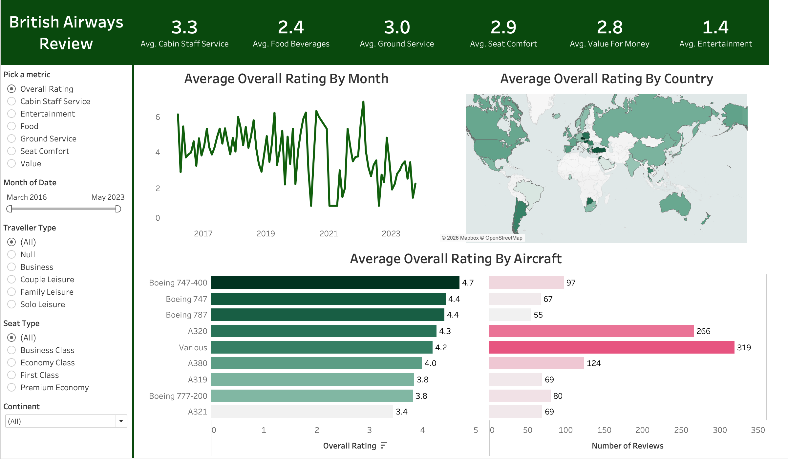
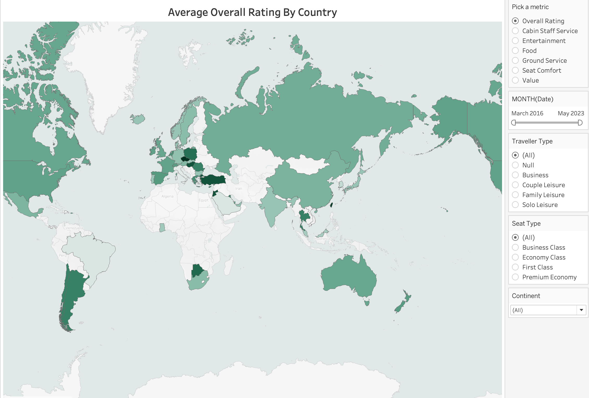
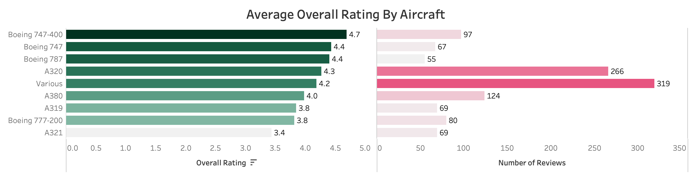

# British Airways Review Dashboard

An interactive Tableau dashboard that analyzes British Airways customer reviews from 2016 to 2023. It shows how passengers rate the airline overall and across individual parts of the experience, and how those ratings vary by month, country, aircraft, and type of traveller.

## Questions Explored

- How do passengers rate British Airways overall, and which parts of the experience score best and worst?
- How have ratings changed over time?
- Which countries give the highest and lowest ratings?
- Which aircraft are rated highest, and how many reviews support each rating?
- Do ratings differ by traveller type, seat type, or continent?

## Features

**KPI header.** Average scores for cabin staff service, food and beverages, ground service, seat comfort, value for money, and entertainment.

**Metric selector.** Switches the month chart, map, and aircraft bars between overall rating and the category ratings (cabin staff service, food, ground service, seat comfort, and value). Entertainment is shown in the KPI header.

**Filters.** All charts respond to the following:

| Filter | Options |
|---|---|
| Month | March 2016 to May 2023 (slider) |
| Traveller type | All, Business, Couple Leisure, Family Leisure, Solo Leisure |
| Seat type | All, Business Class, Economy Class, First Class, Premium Economy |
| Continent | All, or a single continent |

**Ratings by month.** A line chart of the selected metric over time.

**Ratings by country.** A filled map where darker green indicates a higher average rating. Countries with no reviews are left blank.

**Ratings by aircraft.** Each aircraft's average rating is shown next to its number of reviews, which makes it clear how many reviews each average is based on.

## Key Findings

- Overall ratings are on a 1 to 10 scale. The average across all 1,324 reviews is 4.2.
- The Boeing 747-400 has the highest average overall rating (4.7), and the A321 has the lowest (3.4).
- The aircraft group with the most reviews is "Various" (319), followed by the A320 (266). Aircraft with fewer reviews, such as the Boeing 787 (55), have less reliable averages.
- Among the category ratings (1 to 5 scale), cabin staff service scores highest at 3.3. Food, entertainment, and value for money are all between roughly 2.7 and 2.8 once unrated reviews are excluded (see Known Limitations).

## How It Works

- A parameter ("Pick a metric") drives a calculated field, `Metric Selected`, which uses a `CASE` statement to choose the rating column to display. The month chart, map, and aircraft bars all use this field, so a single selector updates all three.
- Continent is derived from a second file, `Countries.csv`, matched to each review's country. All 56 countries in the reviews matched.
- Similar aircraft labels are grouped for the aircraft chart.
- The KPI header averages each category directly and responds to the same filters.
- Tools: Tableau Desktop and a Mapbox basemap.

## Data

- **Source:** the Kaggle dataset "Flight Chronicles: An In-depth Analysis of British Airways Reviews (2012-2023)" by willianoliveiragibin (`ba_reviews.csv`), plus `Countries.csv` for mapping countries to continents.
- **Size:** 1,324 reviews from 56 countries, March 2016 to October 2023. The dashboard's date filter ends at May 2023, so the 51 reviews after that date may not be displayed.
- **Ratings:** overall `rating` is on a 1 to 10 scale. The six category ratings (`seat_comfort`, `cabin_staff_service`, `food_beverages`, `ground_service`, `value_for_money`, `entertainment`) are on a 1 to 5 scale.
- **Other fields:** `date`, `place` (reviewer's country), `aircraft`, `traveller_type`, `seat_type`, `route`, `date_flown`, `recommended`, `trip_verified`.

## Known Limitations

I identified these issues after completing the dashboard. I no longer have access to the Tableau workbook, so they remain in the published version.

**Missing ratings are stored as -1.** When a reviewer skipped a category, the dataset recorded it as -1, and the dashboard averages include those values. This lowers several of the KPI figures:

| Category | Unrated reviews | Dashboard average | Average excluding unrated |
|---|---|---|---|
| Entertainment | 457 of 1,324 | 1.4 | 2.7 |
| Food & beverages | 100 of 1,324 | 2.4 | 2.7 |
| Cabin staff service | 11 of 1,324 | 3.3 | 3.3 |
| Seat comfort | 11 of 1,324 | 2.9 | 2.9 |
| Ground service | 4 of 1,324 | 3.0 | 3.0 |
| Value for money | 0 | 2.8 | 2.8 |

Entertainment is the most affected. About a third of reviews have no entertainment rating, so the dashboard's 1.4 understates the true average. The overall rating has no missing values.

**Mixed rating scales.** The overall rating (1 to 10) and the category ratings (1 to 5) share one selector. The aircraft chart's axis ends at 5, even though the overall ratings it displays are out of 10.

## What I Learned

The most important lesson was to inspect the raw data before trusting the averages. Some category ratings were stored as -1 when a reviewer left them blank, which pulled several KPI values down without my noticing. I found the problem only after returning to the CSV, and I now check for placeholder values before building any visualization.

Following the tutorial step by step also taught me how parameters and calculated fields work. Seeing one selector control the map, the line chart, and the aircraft bars showed me how much interactivity a single calculated field can add. Placing review counts next to each aircraft's rating was another detail I learned from the build, because it makes each average easier to interpret.

If I rebuilt this dashboard, I would clean the -1 values first and keep the 1 to 10 overall rating and the 1 to 5 category ratings in separate views so the scales are not mixed.

## Acknowledgments

I followed the AnalyzeWithAnno tutorial ["The Data Analyst Portfolio PROJECT to make you STAND OUT from the crowd | Tableau"](https://www.youtube.com/watch?v=wlQUBjTzsqs) on YouTube to build this dashboard. The design and layout come from that tutorial. The data review and the Known Limitations section are my own work, done after the dashboard was finished.

